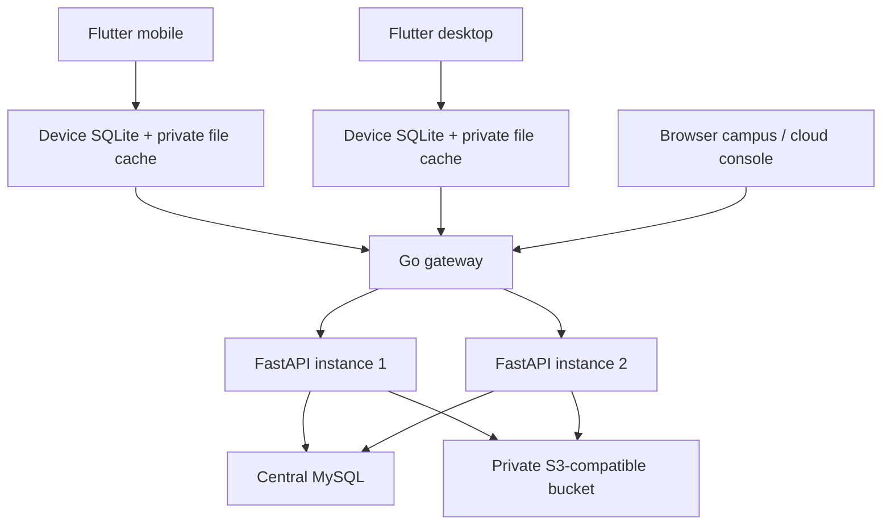

# Architecture and contracts



Native code is shared in one Flutter package, not copied between mobile and desktop. Platform entrypoints and SDK-generated runners are separate. Native local databases are partitioned by normalized API origin and account ID. Tokens are in the OS credential store; passwords are never persisted by the clients.

## Identity

`POST /auth/login` validates the password (and a Google response if configured), returns the original user fields plus an opaque token and expiry, and stores only its SHA-256 hash in central storage. Existing plaintext starter passwords migrate to PBKDF2-SHA256 at initialization. `POST /auth/logout` revokes the current session; `GET /auth/me` returns the validated identity. Protected routes reject caller-supplied `X-User-Id` and inject the verified account for the starter's existing role/ownership checks.

Use TLS outside local development. The native client can restore cached data from a previously signed-in account while offline. It does not verify passwords offline and cannot extend an expired server session. Signing out removes its saved credential; its account-isolated local cache remains so unsynced drafts are recoverable on the next sign-in. Account/device administrators should use OS disk encryption; SQLite content itself is not separately encrypted.

## Record synchronization

SQLite stores `records`, `outbox`, `settings`, `api_cache`, and `files`. A workspace edit and its queued operation are committed together. Record entities are `folder`, `note` and `task`. Operation bodies are limited to 64 KiB. Note content and titles are editable in the Flutter workspace; tasks have completion state. Folders organize notes/tasks/files. Deleting a folder does not cascade-delete its contents; those items remain accessible in the All folders view.

A mutation looks like:

```json
{
  "operation_id": "21818b96-a713-49a7-b536-a38a00e3b813",
  "entity": "note",
  "record_id": "8d5c1da6-ea75-4b52-aa14-09b1052ea668",
  "base_version": 0,
  "body": {"title": "Biology", "text": "Review chapter 1"},
  "deleted": false
}
```

`POST /sync/push` accepts `{"changes":[...]}` (at most 100). Each operation is an independent transaction. The server locks the owner's `sync_heads` row on MySQL; SQLite development uses `BEGIN IMMEDIATE`. The current record version must match `base_version`. Accepted operations increment the owner's revision and persist both the record and its response receipt. Replaying an accepted operation returns the same receipt. Reusing an accepted operation ID with changed data is rejected. A partially processed batch is therefore safe to resend after a disconnect.

A conflict returns `status: conflict` and the server copy without overwriting it. The device retains its local copy and displays both. Choosing Keep my version creates a fresh operation based on the latest server version. Choosing Use server version replaces the local copy and removes the queued edit. An acknowledgment for an earlier in-flight edit only advances the next edit's base version; it cannot overwrite that newer local content.

`GET /sync/pull?after=0&limit=100` returns the latest changed records, an ascending cursor and `has_more`. Pull pages and the cursor commit in one SQLite transaction. Incoming updates to locally dirty records become explicit conflicts. Deletions remain as tombstones. No physical purge or stale-device reset protocol is implemented; keep tombstones/receipts until such a policy exists.

## Files

1. The native picker copies bytes into persistent account-private application storage.
2. The file ID, hash and pending state are committed in SQLite.
3. Folders sync before queued files upload.
4. `POST /cloud/files` accepts multipart `file_id`, optional `folder_id`, and `file`.
5. The API checks session, folder ownership, file limit and quota, stores private object bytes, then saves central metadata.
6. `GET /cloud/files` lists only the current account's files. `include_deleted=true` also returns tombstones, with offset pagination.
7. `GET /cloud/files/{id}/content` streams a private attachment after ownership checks. Flutter verifies its checksum and can retain a downloaded copy offline.
8. `DELETE /cloud/files/{id}` blocks reads first and retries object deletion if the provider is unavailable.

Objects have deterministic user/file/hash keys, and an existing file ID cannot be replaced with different bytes or revived after deletion. This prevents duplicate uploads after a lost response. Provider keys and credentials never appear in metadata responses. Each owner is locked while checking quota and recording uploads, so concurrent API instances cannot independently overspend a quota. Database/object storage do not share a distributed transaction: a crash after storing an object and before committing metadata may leave a private orphan. Upload retry reuses that same key; an administrative orphan-cleanup job can compare central metadata with the bucket when desired. Do not delete objects merely because they were not seen on one paginated query.

There is no file sharing between accounts, public-link feature, chunked resume for very large files, provider-version history UI, malware scanning, or automatic Gabay AI ingestion in this change. File retry resumes an entire bounded upload, not a byte range. Changing an existing file's bytes means creating a new file ID.

## Deployment and operations

MySQL and the object store are shared across API replicas; API processes have no in-memory session or idempotency dependency. The Go gateway round robins healthy backends, probes `/ready` every five seconds, observes connection errors, and recovers instances after they become ready. It does not replay writes. Clients retry only operations designed for that retry contract. `/health` is process health; `/ready` checks schema/database and object storage; gateway `/healthz` counts healthy upstreams.

Local Python mode is a single API plus static frontend, with central-development SQLite and local private file bytes. It preserves the user's ability to run the project on the existing High Sierra/Python setup. The full stack replaces those development services with central MySQL and private MinIO/S3, and includes a one-shot migration container before replicas. To use external managed MySQL/S3, supply real server-side settings from SETUP.md and run migrations once before starting the gateway/API services.

Before using real campus/payment data, extend the starter's business transaction invariants and audit its role model; bookings/billing/payments remain the original prototype implementations. This change secures identity routing and private workspace access but is not an audit of every campus business rule. Login throttling, password recovery, account administration UI, monitoring/backups, and a native CAPTCHA challenge bridge are separate operational work. Never use seeded demo credentials in a public deployment.
